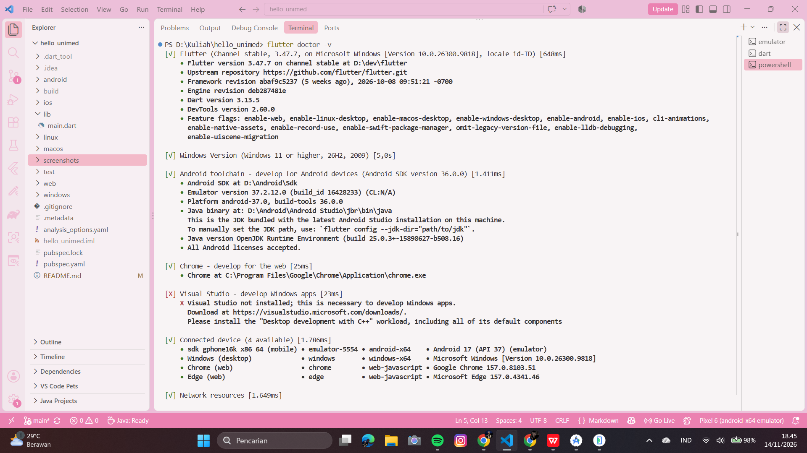
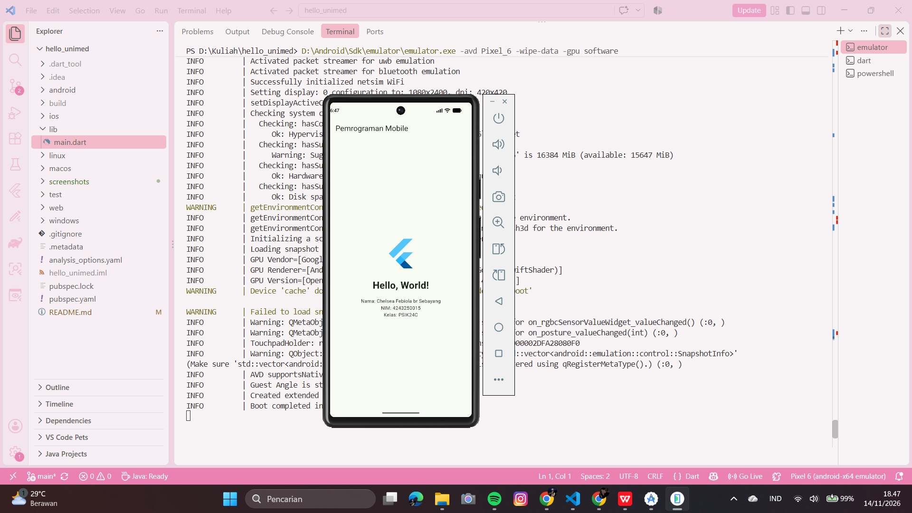

# Flutter Hello World — Pertemuan 01

## 1. Identitas Mahasiswa

- **Nama:** Chelsea Febiola br Sebayang
- **NIM:** 4243250015
- **Kelas:** PSIK24C
- **Program Studi:** Ilmu Komputer
- **Universitas:** Universitas Negeri Medan

## 2. Deskripsi Proyek

Aplikasi sederhana menggunakan Flutter yang menampilkan teks "Hello, World!", identitas mahasiswa, dan widget tambahan sebagai latihan dasar pengembangan aplikasi mobile.

## 3. Informasi Flutter

Hasil pemeriksaan versi Flutter:

```text
Flutter 3.47.7 • channel stable
Dart 3.13.5
DevTools 2.60.0
```

Pengujian aplikasi:

```text
flutter test
00:15 +1: All tests passed!
```

## 4. Screenshot

### Flutter Doctor



### Aplikasi Berjalan di Emulator



## 5. Kendala dan Solusi

**Kendala 1: Android CLI mengalami Access Denied**

- Masalah: Proses ekstraksi Android CLI gagal karena akses ditolak pada folder pengguna di drive C.
- Solusi: Mengubah lokasi `ANDROID_USER_HOME` ke drive D agar file Android CLI disimpan di lokasi yang memiliki ruang dan akses memadai.

**Kendala 2: NDK Android belum terpasang**

- Masalah: Proses menjalankan aplikasi gagal karena NDK versi `28.2.13676358` belum tersedia.
- Solusi: Menginstal versi NDK yang diperlukan melalui Android Studio SDK Manager.

## 6. Perbandingan Native, Hybrid, dan Cross-platform

Native, Hybrid, dan Cross-platform merupakan pendekatan yang digunakan untuk mengembangkan aplikasi mobile. Ketiganya memiliki perbedaan dari segi teknologi, proses pengembangan, dan hasil aplikasi.

Native adalah metode pengembangan aplikasi yang menggunakan bahasa pemrograman khusus sesuai sistem operasi. Contohnya, Kotlin atau Java untuk Android dan Swift untuk iOS. Kelebihan Native adalah performanya optimal dan dapat mengakses fitur perangkat secara langsung. Contoh penggunaannya adalah aplikasi kamera yang membutuhkan akses mendalam terhadap perangkat.

Hybrid merupakan pendekatan yang menggabungkan teknologi web seperti HTML, CSS, dan JavaScript ke dalam aplikasi yang dapat dijalankan melalui wadah aplikasi mobile. Keuntungannya adalah pengembangan relatif lebih sederhana karena dapat menggunakan teknologi web. Contoh penggunaannya adalah aplikasi katalog produk sederhana.

Cross-platform memungkinkan pengembang membuat aplikasi untuk beberapa sistem operasi menggunakan satu basis kode. Salah satu framework yang digunakan adalah Flutter dengan bahasa pemrograman Dart. Pendekatan ini dapat menghemat waktu pengembangan dan mempermudah pemeliharaan aplikasi. Contoh penggunaannya adalah aplikasi layanan pemesanan makanan yang tersedia di Android dan iOS.

Kesimpulannya, setiap pendekatan memiliki kelebihan masing-masing. Pemilihan metode harus disesuaikan dengan kebutuhan aplikasi, target pengguna, biaya, dan performa yang diharapkan.

## 7. Pernyataan Penggunaan AI

Dalam pengerjaan tugas ini, saya menggunakan ChatGPT sebagai alat bantu untuk memahami konsep Flutter, mengatasi kendala teknis, dan membantu penyusunan dokumentasi. Seluruh proses implementasi, pengujian, dan pemeriksaan hasil aplikasi dilakukan serta ditinjau kembali oleh saya.

## 8. Pengujian Aplikasi

Pengujian dilakukan menggunakan perintah `flutter test`.

Hasil pengujian menunjukkan bahwa seluruh pengujian berhasil dengan pesan:

`All tests passed!`

Dengan demikian, aplikasi berhasil melewati pengujian widget untuk memastikan teks "Hello, World!" ditampilkan.